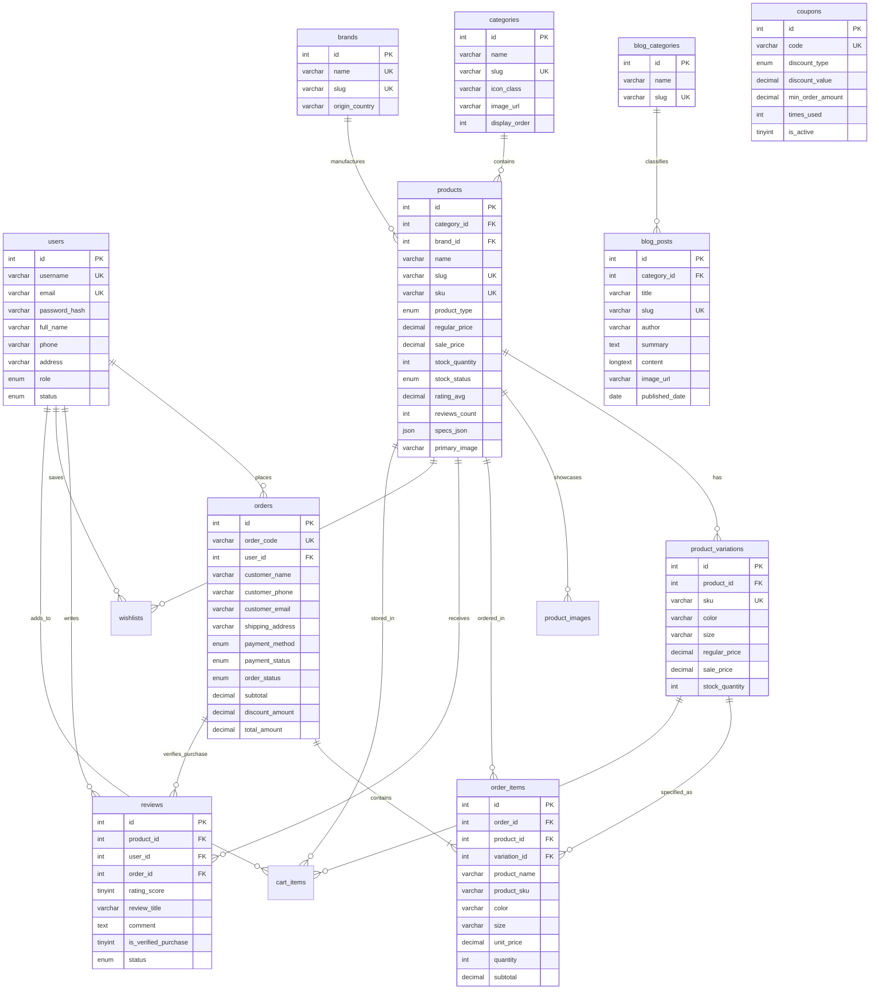

# Thiết kế Cơ sở dữ liệu (Database Architecture & Design) — WOODLUXE

> **Hệ quản trị CSDL:** MySQL 8.0+ / MariaDB 10.4+ (XAMPP Server)  
> **Tên Database:** `woodluxe_db`  
> **Character Set / Collation:** `utf8mb4` / `utf8mb4_unicode_ci`  
> **Tệp DDL / DML:** [`database/woodluxe_db.sql`](file:///c:/Users/ad/Documents/Workspace/e-comm/database/woodluxe_db.sql)  
> **Tệp kết nối PDO:** [`database/db_connect.php`](file:///c:/Users/ad/Documents/Workspace/e-comm/database/db_connect.php)

---

## 1. Sơ đồ Thực thể Liên kết (Entity-Relationship Diagram — ERD)



---

## 2. Chi tiết 14 Bảng trong Cơ sở dữ liệu

### 2.1. Phân hệ Người dùng & Khách hàng

#### Bảng `users` (Tài khoản người dùng)
Quản lý thông tin đăng nhập, phân quyền quản trị và thông tin giao hàng mặc định của khách hàng.

| Tên cột | Kiểu dữ liệu | Thuộc tính | Diễn giải |
|---|---|---|---|
| `id` | `INT UNSIGNED` | `AUTO_INCREMENT`, `PRIMARY KEY` | Định danh người dùng |
| `username` | `VARCHAR(60)` | `NOT NULL`, `UNIQUE` | Tên đăng nhập |
| `email` | `VARCHAR(120)` | `NOT NULL`, `UNIQUE` | Địa chỉ email liên hệ & nhận hóa đơn |
| `password_hash` | `VARCHAR(255)` | `NOT NULL` | Mật khẩu băm an toàn (bcrypt/argon2) |
| `full_name` | `VARCHAR(120)` | `NOT NULL` | Họ và tên khách hàng |
| `phone` | `VARCHAR(20)` | `NULL` | Số điện thoại nhận hàng |
| `address` | `VARCHAR(255)` | `NULL` | Địa chỉ giao nhận mặc định |
| `city` | `VARCHAR(80)` | `DEFAULT 'TP. Hồ Chí Minh'` | Tỉnh / Thành phố |
| `role` | `ENUM('customer','admin','manager')` | `DEFAULT 'customer'` | Vai trò truy cập |
| `status` | `ENUM('active','inactive','banned')` | `DEFAULT 'active'` | Trạng thái tài khoản |
| `created_at` | `TIMESTAMP` | `DEFAULT CURRENT_TIMESTAMP` | Thời điểm đăng ký |

---

### 2.2. Phân hệ Danh mục, Thương hiệu & Sản phẩm

#### Bảng `categories` (6 Danh mục tuyển chọn)
Lưu trữ danh mục gốc khớp với đặc tả sản phẩm (Chairs, Tables, Sofas, Beds, Lighting, Decoration).

| Tên cột | Kiểu dữ liệu | Thuộc tính | Diễn giải |
|---|---|---|---|
| `id` | `INT UNSIGNED` | `AUTO_INCREMENT`, `PRIMARY KEY` | Mã danh mục |
| `name` | `VARCHAR(100)` | `NOT NULL` | Tên danh mục hiển thị |
| `slug` | `VARCHAR(100)` | `NOT NULL`, `UNIQUE` | Đường dẫn tĩnh (SEO) |
| `icon_class` | `VARCHAR(100)` | `NOT NULL` | Lớp icon FontAwesome / Hugeicons |
| `image_url` | `VARCHAR(255)` | `NULL` | Ảnh banner đại diện của danh mục |
| `description` | `VARCHAR(255)` | `NULL` | Mô tả ngắn |
| `display_order` | `INT` | `DEFAULT 0` | Thứ tự ưu tiên sắp xếp |

#### Bảng `brands` (Thương hiệu đối tác)
Quản lý 5 xưởng thiết kế và thương hiệu nội thất đối tác (LuxeStudio, ArtisanHome, Scandinavian Living, NordicCraft, WoodWood).

| Tên cột | Kiểu dữ liệu | Thuộc tính | Diễn giải |
|---|---|---|---|
| `id` | `INT UNSIGNED` | `AUTO_INCREMENT`, `PRIMARY KEY` | Mã thương hiệu |
| `name` | `VARCHAR(100)` | `NOT NULL`, `UNIQUE` | Tên hãng |
| `slug` | `VARCHAR(100)` | `NOT NULL`, `UNIQUE` | Slug URL |
| `origin_country` | `VARCHAR(60)` | `NULL` | Xuất xứ (Ý, Đan Mạch, Nhật Bản, Đức) |
| `description` | `TEXT` | `NULL` | Giới thiệu nghệ thuật chế tác |

#### Bảng `products` (20 Sản phẩm nội thất cao cấp)
Lưu trữ toàn diện 20 sản phẩm theo chuẩn `products.csv` với đầy đủ giá niêm yết, khuyến mãi, tồn kho và thông số kỹ thuật (specs).

| Tên cột | Kiểu dữ liệu | Thuộc tính | Diễn giải |
|---|---|---|---|
| `id` | `INT UNSIGNED` | `AUTO_INCREMENT`, `PRIMARY KEY` | Mã định danh sản phẩm (1..20) |
| `category_id` | `INT UNSIGNED` | `NOT NULL`, `FK` | Tham chiếu `categories(id)` |
| `brand_id` | `INT UNSIGNED` | `NULL`, `FK` | Tham chiếu `brands(id)` |
| `name` | `VARCHAR(200)` | `NOT NULL` | Tên thương mại sản phẩm |
| `slug` | `VARCHAR(200)` | `NOT NULL`, `UNIQUE` | Slug thân thiện URL |
| `sku` | `VARCHAR(50)` | `NOT NULL`, `UNIQUE` | Mã kiểm kê kho hàng (VD: `SOFA-RED-01`) |
| `product_type` | `ENUM('simple','variable','sale')` | `DEFAULT 'simple'` | Loại sản phẩm WooCommerce |
| `regular_price` | `DECIMAL(14,2)` | `NOT NULL` | Giá niêm yết chuẩn (VNĐ) |
| `sale_price` | `DECIMAL(14,2)` | `NULL` | Giá ưu đãi nếu có (VNĐ) |
| `stock_quantity`| `INT` | `DEFAULT 0` | Số lượng tồn kho thực tế |
| `stock_status` | `ENUM('instock','outofstock','onbackorder')` | `DEFAULT 'instock'` | Trạng thái hiển thị |
| `rating_avg` | `DECIMAL(3,2)` | `DEFAULT 5.00` | Điểm sao trung bình (1.00 – 5.00) |
| `reviews_count` | `INT UNSIGNED` | `DEFAULT 0` | Tổng lượt đánh giá |
| `short_description` | `VARCHAR(500)` | `NULL` | Tóm tắt sản phẩm trên thẻ card |
| `description` | `LONGTEXT` | `NULL` | Mô tả chi tiết trang PDP |
| `specs_json` | `JSON` | `NULL` | Thông số kỹ thuật (Kích thước, Khung, Vật liệu, Bảo hành) |
| `primary_image`| `VARCHAR(255)` | `NOT NULL` | Đường dẫn ảnh đại diện chính |
| `badge` | `VARCHAR(50)` | `NULL` | Huy hiệu nổi bật (`Sale`, `New`, `Hot`) |
| `is_featured` | `TINYINT(1)` | `DEFAULT 0` | Đánh dấu hiển thị mục Nổi bật |
| `is_top_seller` | `TINYINT(1)` | `DEFAULT 0` | Đánh dấu bán chạy |

#### Bảng `product_variations` (Biến thể Color & Size)
Giải quyết ma trận biến thể cho 8 sản phẩm loại `variable`. Mỗi bản ghi mang một mã SKU riêng biệt và có thể có giá/tồn kho riêng.

| Tên cột | Kiểu dữ liệu | Thuộc tính | Diễn giải |
|---|---|---|---|
| `id` | `INT UNSIGNED` | `AUTO_INCREMENT`, `PRIMARY KEY` | Mã biến thể |
| `product_id` | `INT UNSIGNED` | `NOT NULL`, `FK` | Tham chiếu `products(id)` ON DELETE CASCADE |
| `sku` | `VARCHAR(80)` | `NOT NULL`, `UNIQUE` | Mã SKU biến thể (VD: `SOFA-RED-CRM-3S`) |
| `color` | `VARCHAR(80)` | `NULL` | Màu sắc đã chọn |
| `size` | `VARCHAR(80)` | `NULL` | Kích thước đã chọn |
| `regular_price` | `DECIMAL(14,2)` | `NOT NULL` | Giá niêm yết theo biến thể |
| `sale_price` | `DECIMAL(14,2)` | `NULL` | Giá khuyến mãi theo biến thể |
| `stock_quantity`| `INT` | `DEFAULT 10` | Số lượng tồn kho của cấu hình này |
| `image_url` | `VARCHAR(255)` | `NULL` | Ảnh chụp riêng của biến thể màu |

---

### 2.3. Phân hệ Bán hàng, Giỏ hàng & Đơn hàng

#### Bảng `coupons` (Mã giảm giá)
Lưu trữ các mã ưu đãi của hệ thống (ví dụ: `WOODLUXE10` giảm 10%, `FREESHIP` miễn phí vận chuyển).

| Tên cột | Kiểu dữ liệu | Thuộc tính | Diễn giải |
|---|---|---|---|
| `id` | `INT UNSIGNED` | `AUTO_INCREMENT`, `PRIMARY KEY` | Mã coupon |
| `code` | `VARCHAR(50)` | `NOT NULL`, `UNIQUE` | Mã voucher viết hoa (VD: `WOODLUXE10`) |
| `discount_type`| `ENUM('percentage','fixed_amount','free_shipping')` | `NOT NULL` | Hình thức khấu trừ |
| `discount_value`| `DECIMAL(12,2)` | `NOT NULL` | Tỷ lệ % (10%) hoặc số tiền giảm cố định |
| `min_order_amount`| `DECIMAL(14,2)` | `DEFAULT 0.00` | Giá trị đơn tối thiểu để áp dụng |
| `max_discount_amount`| `DECIMAL(14,2)`| `NULL` | Mức giảm tối đa |
| `times_used` | `INT` | `DEFAULT 0` | Số lượt đã sử dụng |
| `is_active` | `TINYINT(1)` | `DEFAULT 1` | Trạng thái kích hoạt |

#### Bảng `orders` (Quản lý đơn hàng)
Lưu trữ thông tin đặt hàng, tổng tiền, phương thức thanh toán và trạng thái xử lý đơn.

| Tên cột | Kiểu dữ liệu | Thuộc tính | Diễn giải |
|---|---|---|---|
| `id` | `INT UNSIGNED` | `AUTO_INCREMENT`, `PRIMARY KEY` | ID nội bộ |
| `order_code` | `VARCHAR(50)` | `NOT NULL`, `UNIQUE` | Mã đơn hàng hiển thị (`WLX-YYYYMMDD-XXXX`) |
| `user_id` | `INT UNSIGNED` | `NULL`, `FK` | Tham chiếu `users(id)` ON DELETE SET NULL |
| `customer_name`| `VARCHAR(120)` | `NOT NULL` | Tên người nhận hàng |
| `customer_phone`| `VARCHAR(20)` | `NOT NULL` | Số điện thoại nhận hàng |
| `customer_email`| `VARCHAR(120)` | `NOT NULL` | Email xác nhận |
| `shipping_address`| `VARCHAR(255)` | `NOT NULL` | Địa chỉ chi tiết |
| `payment_method`| `ENUM('COD','BANK_TRANSFER','VNPAY','MOMO')` | `DEFAULT 'COD'` | Hình thức thanh toán |
| `payment_status`| `ENUM('pending','paid','failed','refunded')` | `DEFAULT 'pending'` | Tình trạng thanh toán |
| `order_status` | `ENUM('pending','processing','shipping','completed','cancelled')` | `DEFAULT 'processing'` | Trạng thái đơn |
| `subtotal` | `DECIMAL(14,2)` | `NOT NULL` | Tiền hàng chưa giảm |
| `discount_amount`| `DECIMAL(14,2)`| `DEFAULT 0.00` | Số tiền giảm do mã coupon |
| `coupon_code` | `VARCHAR(50)` | `NULL` | Mã giảm giá đã áp dụng |
| `shipping_fee` | `DECIMAL(14,2)` | `DEFAULT 0.00` | Cước giao hàng & lắp đặt |
| `total_amount` | `DECIMAL(14,2)` | `NOT NULL` | Tổng tiền thanh toán cuối cùng |
| `created_at` | `TIMESTAMP` | `DEFAULT CURRENT_TIMESTAMP` | Thời điểm đặt hàng |

#### Bảng `order_items` (Chi tiết đơn hàng)
Mỗi bản ghi là một mặt hàng trong đơn hàng, ghi nhận giá và thông số màu/kích thước tại thời điểm chốt đơn.

| Tên cột | Kiểu dữ liệu | Thuộc tính | Diễn giải |
|---|---|---|---|
| `id` | `INT UNSIGNED` | `AUTO_INCREMENT`, `PRIMARY KEY` | Mã bản ghi |
| `order_id` | `INT UNSIGNED` | `NOT NULL`, `FK` | Tham chiếu `orders(id)` ON DELETE CASCADE |
| `product_id` | `INT UNSIGNED` | `NULL`, `FK` | Tham chiếu `products(id)` ON DELETE SET NULL |
| `variation_id` | `INT UNSIGNED` | `NULL`, `FK` | Tham chiếu `product_variations(id)` |
| `product_name` | `VARCHAR(200)` | `NOT NULL` | Snapshot tên sản phẩm |
| `product_sku` | `VARCHAR(80)` | `NOT NULL` | Snapshot SKU |
| `color` | `VARCHAR(80)` | `NULL` | Màu sắc khách chọn |
| `size` | `VARCHAR(80)` | `NULL` | Kích cỡ khách chọn |
| `unit_price` | `DECIMAL(14,2)` | `NOT NULL` | Đơn giá tại thời điểm mua |
| `quantity` | `INT` | `DEFAULT 1` | Số lượng mua |
| `subtotal` | `DECIMAL(14,2)` | `NOT NULL` | Thành tiền (`unit_price * quantity`) |

---

### 2.4. Phân hệ Đánh giá, Yêu thích & Tương tác

#### Bảng `reviews` (Đánh giá kèm Ràng buộc Mua hàng — Verified Purchase)
> [!IMPORTANT]
> **Quy tắc Nghiệp vụ cốt lõi:** Chỉ khách hàng đã hoàn thành đơn hàng có chứa sản phẩm đó mới được phép tạo đánh giá trong bảng này (`is_verified_purchase = 1`, liên kết với `order_id`). Mỗi khách hàng chỉ được đánh giá 1 lần trên 1 sản phẩm (`UNIQUE(product_id, user_id)`).

| Tên cột | Kiểu dữ liệu | Thuộc tính | Diễn giải |
|---|---|---|---|
| `id` | `INT UNSIGNED` | `AUTO_INCREMENT`, `PRIMARY KEY` | Mã nhận xét |
| `product_id` | `INT UNSIGNED` | `NOT NULL`, `FK` | Sản phẩm được đánh giá |
| `user_id` | `INT UNSIGNED` | `NOT NULL`, `FK` | Tài khoản khách hàng gửi đánh giá |
| `order_id` | `INT UNSIGNED` | `NULL`, `FK` | Đơn hàng làm căn cứ kiểm chứng mua hàng |
| `rating_score` | `TINYINT UNSIGNED` | `CHECK (1..5)` | Số sao đánh giá (1 đến 5 sao) |
| `review_title` | `VARCHAR(150)` | `NULL` | Tiêu đề cảm nhận ngắn |
| `comment` | `TEXT` | `NULL` | Nội dung nhận xét chi tiết |
| `is_verified_purchase` | `TINYINT(1)` | `DEFAULT 1` | Cờ xác thực khách đã mua hàng thật |
| `status` | `ENUM('approved','pending','rejected')` | `DEFAULT 'approved'` | Kiểm duyệt nội dung |
| `created_at` | `TIMESTAMP` | `DEFAULT CURRENT_TIMESTAMP` | Thời điểm đánh giá |

#### Bảng `wishlists` (Danh sách yêu thích)
Lưu trữ danh sách ID các sản phẩm mà khách hàng đã thả tim yêu thích. Khóa kết hợp `(user_id, product_id)` là `UNIQUE`.

#### Bảng `cart_items` (Giỏ hàng máy chủ)
Đồng bộ giỏ hàng với cơ sở dữ liệu khi khách hàng đăng nhập, giúp khách duy trì giỏ hàng khi đổi thiết bị.

---

### 2.5. Phân hệ Tin tức & Khách hàng tiềm năng

#### Bảng `blog_categories` & `blog_posts`
Lưu trữ 6 bài viết cẩm nang nội thất chia làm 3 chuyên mục (`Interior Design`, `Material & Craft`, `Smart Living`) đồng bộ từ `blog.csv`.

#### Bảng `consultation_leads`
Thu thập thông tin khách hàng đăng ký nhận tư vấn bản vẽ 3D từ các kiến trúc sư WOODLUXE và đăng ký nhận bản tin định kỳ.

---

## 3. Chức năng Nâng cao (Views & Stored Procedures)

### 3.1. View `v_product_catalog`
View tổng hợp phục vụ hiển thị nhanh catalog ở trang chủ và trang shop, tính toán sẵn `effective_price` và cờ `is_on_sale` mà không cần join thủ công ở tầng ứng dụng:

```sql
SELECT * FROM v_product_catalog WHERE category_slug = 'sofas';
```

### 3.2. Stored Procedure `sp_check_user_can_review`
Thủ tục kiểm tra trực tiếp từ CSDL xem một `user_id` đã mua `product_id` hay chưa:

```sql
CALL sp_check_user_can_review(2, 1, @can_review, @order_id);
SELECT @can_review, @order_id;
-- Kết quả: can_review = 1, order_id = 1 (Được phép đánh giá)
```

---

## 4. Hướng dẫn Quản lý trên XAMPP

- **phpMyAdmin:** Truy cập [http://localhost/phpmyadmin/](http://localhost/phpmyadmin/) -> Chọn database `woodluxe_db` để xem dữ liệu dạng bảng.
- **Tệp nguồn SQL:** [`database/woodluxe_db.sql`](file:///c:/Users/ad/Documents/Workspace/e-comm/database/woodluxe_db.sql).
- **Kết nối PHP PDO:** Có thể gọi trực tiếp `require_once 'database/db_connect.php';` để tương tác với đối tượng `$pdo`.

